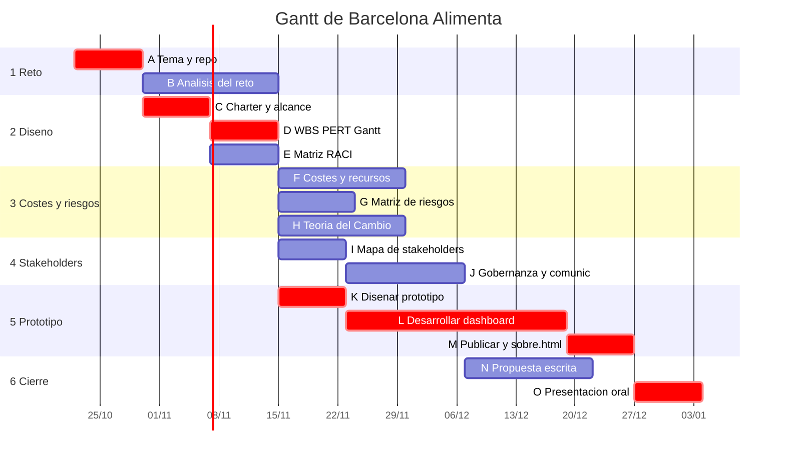

[plan.md](https://github.com/user-attachments/files/33818204/plan.md)
# Plan del proyecto: Barcelona Alimenta

Las fechas son orientativas (inicio 22/10/2026) y hay que ajustarlas al calendario real de entregas. Las duraciones están en semanas; los datos a/m/b son estimaciones del grupo para la plantilla Excel de PERT.

## 1. WBS

```
Barcelona Alimenta (propuesta + prototipo)
├─ 1. Reto e idea
│   ├─ A  Elegir enfoque y tema, crear repo y README
│   └─ B  Análisis del reto, datos y beneficiarios
├─ 2. Diseño y plan de gestión
│   ├─ C  Project charter, objetivos y alcance
│   ├─ D  WBS, PERT y Gantt
│   └─ E  Matriz RACI
├─ 3. Costes, riesgos e impacto
│   ├─ F  Costes, recursos y financiación
│   ├─ G  Matriz de riesgos
│   └─ H  Teoría del Cambio e indicadores de impacto
├─ 4. Stakeholders, gobernanza y comunicación
│   ├─ I  Mapa de stakeholders
│   └─ J  Gobernanza y estrategia de comunicación
├─ 5. Prototipo
│   ├─ K  Diseñar el prototipo (preguntas, indicadores, wireframe)
│   ├─ L  Desarrollar el dashboard (datos, mapa, indicadores)
│   └─ M  Publicar en GitHub Pages y redactar sobre.html
└─ 6. Cierre
    ├─ N  Redactar la propuesta escrita
    └─ O  Preparar y ensayar la presentación oral
```

## 2. Actividades, dependencias y PERT

te = (a + 4m + b) / 6 · σ² = ((b − a) / 6)²

| ID | Actividad | Predec. | a | m | b | te | σ² | Responsable |
|---|---|---|---|---|---|---|---|---|
| A | Elegir enfoque y tema, crear repo y README | · | 1 | 1 | 2 | 1,17 | 0,03 | Oriol |
| B | Análisis del reto, datos y beneficiarios | A | 1 | 2 | 5 | 2,33 | 0,44 | Hèctor |
| C | Project charter, objetivos y alcance | A | 1 | 1 | 2 | 1,17 | 0,03 | Oriol |
| D | WBS, PERT y Gantt | C | 1 | 1 | 2 | 1,17 | 0,03 | Oriol |
| E | Matriz RACI | C | 1 | 1 | 2 | 1,17 | 0,03 | Oriol |
| F | Costes, recursos y financiación | D | 1 | 2 | 4 | 2,17 | 0,25 | Xavier |
| G | Matriz de riesgos | D | 1 | 1 | 3 | 1,33 | 0,11 | Xavier |
| H | Teoría del Cambio e indicadores | B | 1 | 2 | 4 | 2,17 | 0,25 | Xavier |
| I | Mapa de stakeholders | B | 1 | 1 | 2 | 1,17 | 0,03 | Pol |
| J | Gobernanza y comunicación | I, E | 1 | 2 | 3 | 2,00 | 0,11 | Pol |
| K | Diseñar el prototipo | D | 1 | 1 | 2 | 1,17 | 0,03 | Hèctor |
| L | Desarrollar el dashboard | K | 2 | 3 | 8 | 3,67 | 1,00 | Hèctor |
| M | Publicar y redactar sobre.html | L | 1 | 1 | 2 | 1,17 | 0,03 | Hèctor |
| N | Redactar la propuesta escrita | F, G, H, J | 1 | 2 | 4 | 2,17 | 0,25 | Xavier |
| O | Preparar la presentación oral | N, M | 1 | 1 | 2 | 1,17 | 0,03 | Todos (Oriol coordina) |

**Resultado (con estas estimaciones)**

- Ruta crítica: **A · C · D · K · L · M · O**
- Duración esperada: **T ≈ 10,7 semanas**
- σ² del proyecto (suma de las críticas) ≈ 1,17 → σ ≈ 1,08
- Holguras aproximadas: B, I y J ≈ 0,7 sem. · H y F ≈ 1,7 sem. · E ≈ 1,8 sem. · G ≈ 2,5 sem. · N ≈ 0,7 sem.
- Probabilidad de plazo: con las fechas del plan, el calendario termina el 04/01/2027 (T ≈ 10,6 semanas desde el 22/10/2026). Para un plazo supuesto de 12 semanas (14/01/2027): P(T ≤ 12) ≈ 89 % (z = (12 − 10,7) / 1,08 ≈ 1,23). Para otro plazo, z = (plazo − 10,7) / 1,08 y `DISTR.NORM.ESTAND(z)` en Excel.

**Lectura:** la actividad más incierta es L (desarrollar el dashboard), y además es crítica. Para reducir el riesgo: validar pronto que los datasets existen y se pueden cruzar por barrio (en B y K), empezar con un prototipo mínimo y añadir funciones después.

## 3. Gantt



(Las barras marcadas como críticas son las de la ruta crítica.)

## 4. Tablero Kanban (GitHub Projects)

1. Projects → New project → **Board**.
2. Crear una issue por actividad (A–O), copiando el título de la tabla y asignando responsable.
3. Etiquetas: `reto`, `diseño`, `costes-riesgos`, `stakeholders`, `prototipo`, `entrega`, `crítica`, `urgente`.
4. Campos personalizados: **Start** y **End** (fechas de la tabla siguiente) → vista **Roadmap**.
5. Columnas: **Por hacer · En curso · En revisión · Hecho**. Límite de 2 o 3 tarjetas por persona en «En curso».
6. Reunión semanal de 15 minutos: revisar el tablero y actualizar el Gantt.

| ID | Etiqueta | Inicio | Fin |
|---|---|---|---|
| A | reto, crítica | 22/10/2026 | 30/10/2026 |
| B | reto | 30/10/2026 | 15/11/2026 |
| C | diseño, crítica | 30/10/2026 | 07/11/2026 |
| D | diseño, crítica | 07/11/2026 | 15/11/2026 |
| E | diseño | 07/11/2026 | 15/11/2026 |
| F | costes-riesgos | 15/11/2026 | 30/11/2026 |
| G | costes-riesgos | 15/11/2026 | 24/11/2026 |
| H | costes-riesgos | 15/11/2026 | 30/11/2026 |
| I | stakeholders | 15/11/2026 | 23/11/2026 |
| J | stakeholders | 23/11/2026 | 07/12/2026 |
| K | prototipo, crítica | 15/11/2026 | 23/11/2026 |
| L | prototipo, crítica | 23/11/2026 | 19/12/2026 |
| M | prototipo, crítica | 19/12/2026 | 27/12/2026 |
| N | entrega | 07/12/2026 | 22/12/2026 |
| O | entrega, crítica | 27/12/2026 | 04/01/2027 |

## 5. Riesgos principales (para la matriz de la tarea G)

| Riesgo | Prob. | Xavier | Respuesta |
|---|---|---|---|
| Un dataset no existe, está desactualizado o no se puede cruzar por barrio | Media | Alto | Validar los datasets en la tarea B; tener una alternativa |
| El dashboard generado con IA contiene errores | Media | Alto | Revisar números a mano con una muestra (como en el prompt 3) |
| Reparto desigual del trabajo en el grupo | Media | Medio | RACI y revisión semanal del tablero |
| Retrasos por otras entregas del cuatrimestre | Alta | Medio | Holguras visibles en el Gantt y priorizar la ruta crítica |
| Dificultad para contactar con stakeholders reales | Media | Bajo | Basarse en fuentes públicas y documentar los intereses |

## 6. Matriz RACI inicial

R = hace el trabajo · A = aprueba y responde del resultado · C = consultado · I = informado

| Actividad | Oriol | Xavier | Hèctor | Pol |
|---|---|---|---|---|
| A Tema y repo | A/R | C | C | C |
| B Análisis del reto y datos | A | C | R | C |
| C-D Charter, WBS, PERT y Gantt | A/R | C | C | C |
| E Matriz RACI | A/R | C | C | C |
| F Costes y financiación | A | R | C | I |
| G Matriz de riesgos | A | R | C | C |
| H Teoría del Cambio e indicadores | A | R | C | C |
| I Mapa de stakeholders | A | C | I | R |
| J Gobernanza y comunicación | A | C | I | R |
| K-M Prototipo (diseño, dashboard, publicación) | A | C | R | C |
| N Propuesta escrita | A | R | C | C |
| O Presentación oral | A/R | R | R | R |
